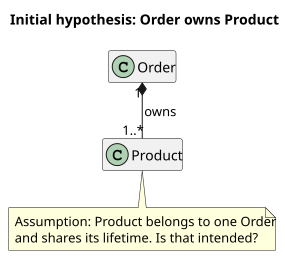
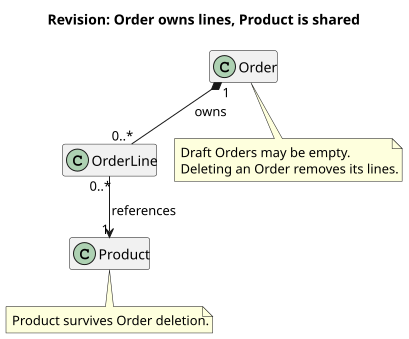
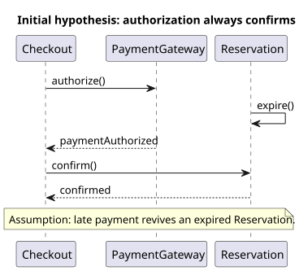
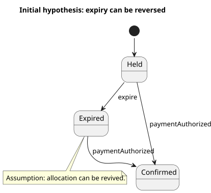
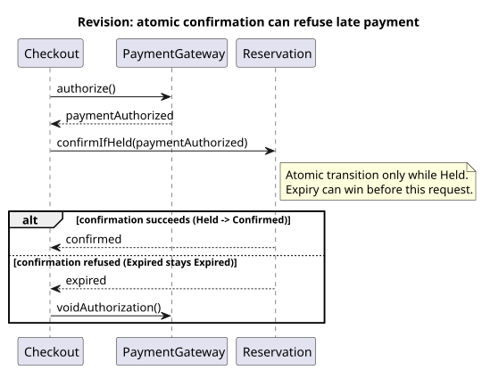
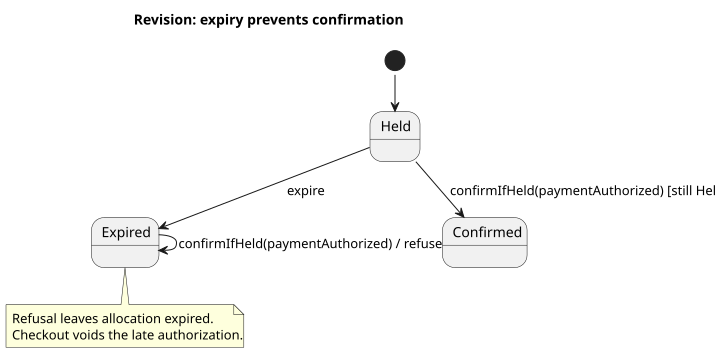
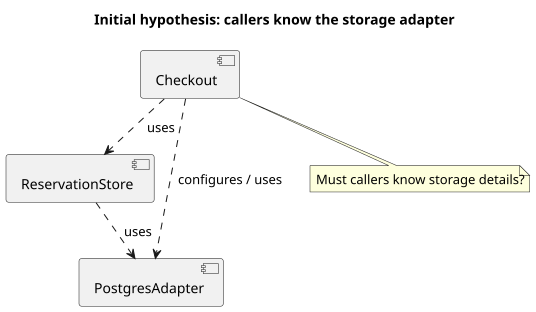
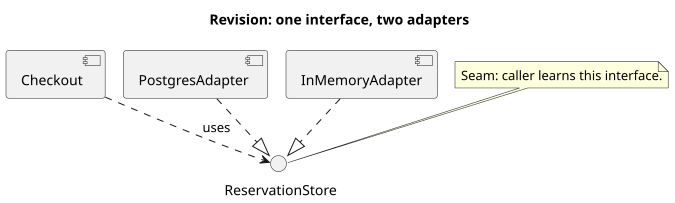

# Teaching examples: selection and refinement

Read the matching case when choosing or refining domain, interaction/lifecycle, or structure views. These are illustrative proposed designs, not accepted project diagrams or claims about running software. The answers below are hypothetical teaching inputs. Each preview is generated from the linked editable source; initial assumptions are deliberately exposed for discussion.

The eight sources were rendered locally to SVG and PNG with the pinned baseline in [rendering.md](rendering.md). The PNG previews were visually inspected for labels, directions, multiplicities, guards, and clipping; their intended UML meaning and consistency with the prose and complementary views were checked separately. Regenerate and inspect previews again when editing these examples.

## Domain relationships: who owns a product?

**Question:** Can the same Product appear in two Orders, and what survives deleting an Order? A class view makes ownership and multiplicity testable without incidental fields.

Initial sketch: [source](../examples/order-ownership-initial.puml), [SVG](../examples/order-ownership-initial.svg).

**Exposed assumption:** composition makes Product a part owned by one Order. Ask: "I recommend that Product is a shared catalog identity. Can two Orders reference it, and should deleting an Order leave that Product intact?" The initial `1..*` also assumes every Order already has a product.

**Answer changes the model:** yes, Product survives and is shared; a draft Order can be empty. Introduce OrderLine as the owned part. Each line references one Product, and a Product can be referenced by many lines. The Order owns zero or more lines. This distinguishes identity from ownership and captures the draft lifecycle constraint without adding irrelevant attributes.

Revised sketch: [source](../examples/order-ownership-revised.puml), [SVG](../examples/order-ownership-revised.svg).

Re-render and ask whether deleting an Order now removes only its lines. If that answer changes, revise these relationships instead of treating the example as an approved rule.

## Interaction and lifecycle: late payment authorization

**Question:** What happens if payment authorization arrives after a Reservation expires? Use both a sequence view for ordering and a state view for allowed transitions. Each supplies useful information immediately.

Initial sketches: sequence [source](../examples/reservation-interaction-initial.puml), [SVG](../examples/reservation-interaction-initial.svg); state [source](../examples/reservation-lifecycle-initial.puml), [SVG](../examples/reservation-lifecycle-initial.svg).

**Exposed assumption:** the sequence confirms after authorization without checking expiry, and the state view explicitly allows an expired Reservation to become confirmed. Ask: "I recommend expiry remains final for allocation. Should a late authorization be voided instead of reviving the Reservation?" Showing only the happy-path sequence could hide this choice.

**Answer changes the model:** yes. Confirmation is an atomic guarded transition from Held. Expired stays Expired; the payment authorization is voided when confirmation is refused. The revised sequence branches on the result of `confirmIfHeld`, rather than reading status and confirming later, which would leave a race. The state view specifies the legal transition and the late-event effect.

Revised sketches: sequence [source](../examples/reservation-interaction-revised.puml), [SVG](../examples/reservation-interaction-revised.svg); state [source](../examples/reservation-lifecycle-revised.puml), [SVG](../examples/reservation-lifecycle-revised.svg).

Both views use the same Reservation, events, and outcomes. The sequence shows one request's messages; the state view covers allowed transitions within the Held/Expired/Confirmed scope. Neither specifies payment transport retries. Make that scope explicit rather than implying complete payment behavior.

## Software structure: where does the seam live?

**Question:** Must callers know which storage adapter is in use? Choose a component view to expose interface and dependency direction. Components depict modules here; the calling codebase-design vocabulary remains module, interface, seam, and adapter.

Initial sketch: [source](../examples/storage-seam-initial.puml), [SVG](../examples/storage-seam-initial.svg).

**Exposed assumption:** both Checkout and ReservationStore depend directly on PostgresAdapter. Ask: "I recommend callers only learn the ReservationStore interface. Is an in-memory adapter also needed for this same seam?" Another option is retaining direct dependencies if storage really is part of the caller's contract; show that alternative when consequential.

**Answer changes the model:** yes, the same store interface must work with Postgres and an in-memory adapter. Checkout depends on the small ReservationStore interface. Both adapters realize that interface; the seam has two actual adapters. This is a proposed compile-time dependency view, not a deployment diagram or proof of runtime configuration.

Revised sketch: [source](../examples/storage-seam-revised.puml), [SVG](../examples/storage-seam-revised.svg).

Check whether operations and invariants really stay behind the interface. If placement across processes affects the decision, add a deployment view with explicit scope rather than overloading this arrow with runtime meaning.
